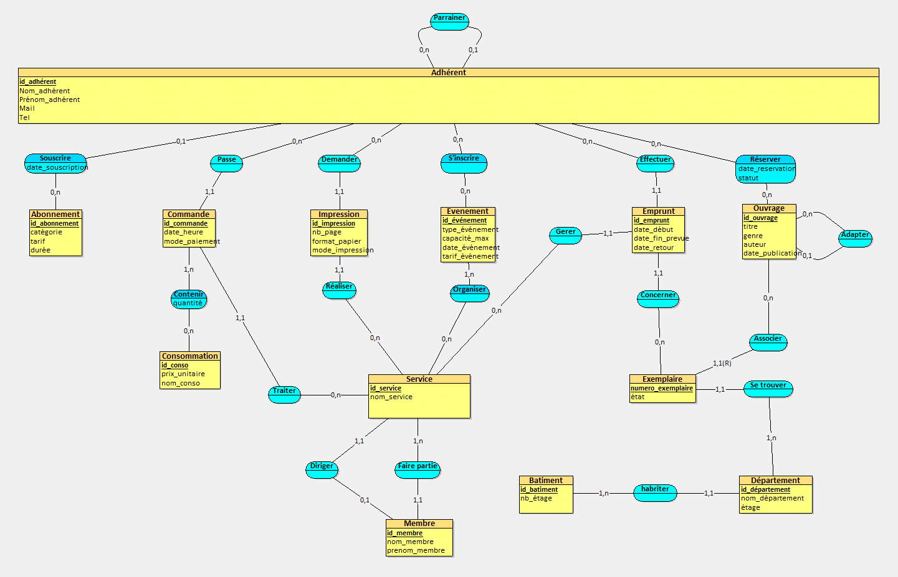

# ProjetDB_SACKO_SAHLI

**Domaine : café-bibliothèque et espace de travail culturel**
(inspiré de l'Anticafé, du Book-Shop et d'ICI Librairie)

Groupe : _Alimata Sacko et Lise Sahli_

L'entreprise fictive propose un espace convivial qui combine restauration légère, prêt de livres, prestations d'impression/reprographie, événements culturels et gestion du personnel.

## Sommaire

1. [Étape 1 – Analyse des besoins](#1-étape-1--analyse-des-besoins)
   - 1.1 Prompt utilisé 
   - 1.2 Dictionnaire de données renvoyé par l'IA
   - 1.3 Analyse du résultat de l'IA
2. [Étape 2 – MCD](#2-étape-2--mcd)
   - 2.1 Le MCD
   - 2.2 Éléments de modélisation avancée (associations récursives, entité faible / forte)
   - 2.3 Différences entre le dictionnaire de l'IA et notre MCD (ajouts, modifications, suppressions)

## 1. Étape 1 – Analyse des besoins

### 1.1 Prompt utilisé

Le prompt soumis à l'IA est le suivant :

Tu travailles dans le domaine du café-bibliothèque et de l'espace de travail culturel. Ton entreprise a comme activité de proposer un espace convivial combinant de la restauration légère, un service de prêt de livres, la vente de prestations d'impression/reprographie, l'organisation d'événements culturels et la gestion du personnel. C'est une entreprise comme l'Anticafé, Le Book-Shop ou ICI Librairie. Des données ont été collectées sur les membres/abonnés, le catalogue de livres et leurs exemplaires physiques, la carte des consommations, les commandes passées, les travaux d'impression, les événements organisés, ainsi que les employés qui traitent les opérations. Inspire-toi des sites web suivants : https://www.anticafe.eu et https://www.icilibrairie.fr.

Ton entreprise veut appliquer MERISE pour concevoir un système d'information. Tu es chargé de la partie analyse, c'est-à-dire de collecter les besoins auprès de l'entreprise. Elle a fait appel à un étudiant en ingénierie informatique pour réaliser ce projet, tu dois lui fournir les informations nécessaires pour qu'il applique ensuite lui-même les étapes suivantes de conception et développement de la base de données.

D'abord, établis les règles de gestion des données de ton entreprise, sous la forme d'une liste à puces. Elles doivent inclure :

- Le parrainage entre membres (un membre peut en parrainer d'autres).
- L'identification des exemplaires physiques rattachés à un ouvrage/livre générique.
- L'enregistrement des emprunts de livres impliquant le membre, l'exemplaire et l'employé qui enregistre le prêt.
- La gestion des commandes de consommations et des services d'impression.
- L'inscription des membres aux événements culturels.

Ensuite, à partir de ces règles, fournis un dictionnaire de données brutes avec les colonnes suivantes, regroupées dans un tableau : signification de la donnée, type, taille en nombre de caractères ou de chiffres. Il doit y avoir entre 25 et 35 données au total. Il sert à fournir des informations supplémentaires sur chaque donnée (taille et type) mais sans a priori sur comment les données vont être modélisées ensuite.

Fournis donc les règles de gestion et le dictionnaire de données.

### 1.2 Dictionnaire de données renvoyé par l'IA

| N° | Donnée | Signification | Type | Taille |
|---|---|---|---|---|
| 1 | id_membre | Identifiant unique d'un membre/abonné | Entier | 10 chiffres |
| 2 | nom_membre | Nom de famille du membre | Texte | 50 caractères |
| 3 | prenom_membre | Prénom du membre | Texte | 50 caractères |
| 4 | date_naissance | Date de naissance du membre | Date | 10 caractères (AAAA-MM-JJ) |
| 5 | email_membre | Adresse électronique du membre | Texte | 254 caractères |
| 6 | telephone_membre | Numéro de téléphone du membre | Texte | 20 caractères |
| 7 | date_adhesion | Date d'inscription du membre | Date | 10 caractères (AAAA-MM-JJ) |
| 8 | id_parrain | Identifiant du membre ayant parrainé un autre membre, si applicable | Entier | 10 chiffres |
| 9 | id_ouvrage | Identifiant d'un ouvrage générique du catalogue | Entier | 10 chiffres |
| 10 | titre_ouvrage | Titre de l'ouvrage | Texte | 200 caractères |
| 11 | auteur_ouvrage | Nom de l'auteur ou des auteurs | Texte | 200 caractères |
| 12 | isbn | Numéro ISBN de l'ouvrage, si disponible | Texte | 13 chiffres (hors séparateurs) |
| 13 | annee_publication | Année de publication de l'ouvrage | Entier | 4 chiffres |
| 14 | id_exemplaire | Identifiant d'un exemplaire physique | Entier | 10 chiffres |
| 15 | code_barres_exemplaire | Code-barres apposé à l'exemplaire | Texte | 30 caractères |
| 16 | etat_exemplaire | État constaté de l'exemplaire (neuf, bon, usé, etc.) | Texte | 20 caractères |
| 17 | date_acquisition | Date d'acquisition de l'exemplaire | Date | 10 caractères (AAAA-MM-JJ) |
| 18 | id_emprunt | Identifiant d'un emprunt | Entier | 10 chiffres |
| 19 | date_emprunt | Date d'enregistrement du prêt | Date/Heure | 19 caractères (AAAA-MM-JJ HH:MM:SS) |
| 20 | date_retour_prevue | Date prévue de retour de l'exemplaire | Date | 10 caractères (AAAA-MM-JJ) |
| 21 | date_retour_effective | Date effective de retour, si le livre est rendu | Date | 10 caractères (AAAA-MM-JJ) |
| 22 | id_employe | Identifiant d'un employé | Entier | 10 chiffres |
| 23 | nom_employe | Nom de famille de l'employé | Texte | 50 caractères |
| 24 | prenom_employe | Prénom de l'employé | Texte | 50 caractères |
| 25 | fonction_employe | Fonction ou rôle de l'employé | Texte | 50 caractères |
| 26 | id_commande | Identifiant d'une commande de consommations | Entier | 10 chiffres |
| 27 | date_commande | Date et heure de la commande | Date/Heure | 19 caractères (AAAA-MM-JJ HH:MM:SS) |
| 28 | montant_commande | Montant total de la commande | Décimal | 10 chiffres + 2 décimales |
| 29 | id_consommation | Identifiant d'un produit de la carte (boisson ou nourriture) | Entier | 10 chiffres |
| 30 | libelle_consommation | Nom de la boisson ou du produit alimentaire | Texte | 100 caractères |
| 31 | id_travail_impression | Identifiant d'une prestation d'impression/reprographie | Entier | 10 chiffres |
| 32 | type_impression | Type de prestation (impression, photocopie, reliure, etc.) | Texte | 50 caractères |
| 33 | id_evenement | Identifiant d'un événement culturel | Entier | 10 chiffres |
| 34 | titre_evenement | Titre ou nom de l'événement culturel | Texte | 150 caractères |
| 35 | date_heure_evenement | Date et heure de l'événement | Date/Heure | 19 caractères (AAAA-MM-JJ HH:MM:SS) |

### 1.3 Analyse du résultat de l'IA

Le résultat respecte la demande : une liste de règles de gestion et un tableau de 35 données (entre 25 et 35), avec signification, type et taille. Nous n'avons retiré aucune donnée du dictionnaire fourni par l'IA : toutes les modifications sont faites au niveau du MCD et sont détaillées en [2.3](#23-différences-entre-le-dictionnaire-de-lia-et-notre-mcd).

## 2. Étape 2 – MCD

### 2.1 Le MCD

### 2.2 Éléments de modélisation avancée

Le sujet demande **au moins 2 éléments** parmi : association récursive, association n-aire (n>2), entité faible/forte. Notre MCD en contient **deux types** : des **associations récursives** (Parrainer et Adapter) et une **entité faible** (Exemplaire) rattachée à une **entité forte** (Ouvrage). Nous n'avons pas utilisé d'association n-aire : aucune de nos règles de gestion ne relie trois entités en même temps, nous n'en avons donc pas forcé une.

#### a) Association récursive n°1 : **Parrainer** (Adhérent – Adhérent)

- **Origine** : la règle de gestion « un membre peut en parrainer d'autres » et la donnée `id_parrain` du dictionnaire (n°8).
- **Pourquoi une association récursive ?** Le parrain et le filleul sont tous deux des adhérents. `id_parrain` n'est pas une information propre à l'adhérent : c'est l'identifiant d'un autre adhérent. En MERISE, on ne garde donc pas cette donnée comme attribut, on la représente par une association de l'entité **Adhérent** avec elle-même.
- **Cardinalités** : **(0,n)** côté parrain (un adhérent peut parrainer 0, 1 ou plusieurs adhérents) et **(0,1)** côté filleul (un adhérent a 0 ou 1 parrain : les premiers adhérents n'ont pas de parrain, et personne n'a deux parrains).
- **Conséquence pour la suite** : au passage au MLD, l'association (0,1)–(0,n) deviendra une clé étrangère optionnelle dans la table Adhérent (par exemple `id_parrain`, qui référence `id_adhérent`). La donnée `id_parrain` réapparaîtra donc naturellement dans le modèle logique.

#### b) Association récursive n°2 : **Adapter** (Ouvrage – Ouvrage)

- **Origine** : ajout de notre part, absent du dictionnaire de l'IA.
- **Pourquoi une association récursive ?** Une œuvre du catalogue peut être l'adaptation d'une autre œuvre du même catalogue (par exemple une bande dessinée adaptée d'un roman). Les deux sont des ouvrages, de même nature, d'où le lien d'une entité avec elle-même.
- **Cardinalités** : **(0,1)** côté œuvre adaptée (un ouvrage est l'adaptation d'au plus un ouvrage d'origine) et **(0,n)** côté œuvre d'origine (un ouvrage peut avoir plusieurs adaptations, ou aucune).
- **Conséquence pour la suite** : clé étrangère optionnelle dans la table Ouvrage qui référence `id_ouvrage`.

#### c) Entité faible et entité forte : **Exemplaire** (faible) et **Ouvrage** (forte)

- **Origine** : la règle de gestion « identification des exemplaires physiques rattachés à un ouvrage/livre générique » et les données n°9 (`id_ouvrage`) et n°14 (`id_exemplaire`) du dictionnaire.
- **Entité forte : Ouvrage.** Elle a son propre identifiant `id_ouvrage` et existe indépendamment des exemplaires : un titre peut être au catalogue même si aucun exemplaire n'est disponible (cardinalité 0,n côté Ouvrage).
- **Entité faible : Exemplaire.** Un exemplaire est une copie physique d'un ouvrage et n'a pas de sens sans lui. Son attribut `numero_exemplaire` (exemplaire n°1, n°2, n°3… d'un ouvrage) n'est **pas unique** à lui seul : plusieurs ouvrages ont un « exemplaire n°1 ». Il faut donc le combiner avec l'identifiant de l'ouvrage pour identifier un exemplaire de façon unique. C'est ce qu'on appelle un **identifiant relatif**.
- **Représentation** : l'association **Associer** porte la cardinalité **(1,1)(R)** côté Exemplaire. Le « (R) » signifie que l'exemplaire est identifié relativement à l'ouvrage auquel il est rattaché. Chaque exemplaire appartient à un seul ouvrage, et sa suppression ou son existence dépend de celui-ci.
- **Conséquence pour la suite** : dans le MLD, la table Exemplaire aura une **clé primaire composée** (`id_ouvrage`, `numero_exemplaire`), où `id_ouvrage` est aussi clé étrangère vers Ouvrage. L'association Concerner (Emprunt → Exemplaire) devra donc référencer cette clé composée.
- **Changement par rapport au dictionnaire** : l'IA proposait un `id_exemplaire` indépendant (donnée n°14). Nous l'avons transformé en `numero_exemplaire`, identifiant partiel d'une entité faible.

### 2.3 Différences entre le dictionnaire de l'IA et notre MCD

#### a) Ce que nous avons ajouté

Données ajoutées, absentes du dictionnaire de l'IA :

| Élément | Données ajoutées | Raison |
|---|---|---|
| **Abonnement** (nouvelle entité) + association Souscrire | id_abonnement, catégorie, tarif, durée, date_souscription | Le dictionnaire ne gardait que `date_adhesion`. Un café-bibliothèque propose des formules d'abonnement avec un tarif et une durée, qui ne dépendent pas de l'adhérent mais de la formule |
| **Commande** | mode_paiement | Information utile sur une commande et remplace en partie `montant_commande` |
| **Contenir** (association Commande–Consommation) | quantité | Le dictionnaire ne disait pas ce que contient une commande. Une commande contient plusieurs consommations et une consommation apparaît dans plusieurs commandes : il faut une association avec la quantité |
| **Consommation** | prix_unitaire | Permet de calculer le montant d'une commande au lieu de le stocker |
| **Impression** | nb_page, format_papier | Éléments nécessaires pour décrire une prestation d'impression |
| **Evenement** | type_événement, capacité_max, tarif_événement | Capacité et tarif servent à gérer les inscriptions ; le type remplace le titre |
| **Ouvrage** | genre | Classement du catalogue |
| **Réserver** (nouvelle association Adhérent–Ouvrage) | date_reservation, statut | Un adhérent peut réserver un ouvrage ; absent du dictionnaire |
| **Adapter** (nouvelle association récursive) | – | Voir 3.4 b) |
| **Service** (nouvelle entité) + Traiter, Réaliser, Organiser, Gérer, Diriger, Faire partie | id_service, nom_service | Le dictionnaire reliait les opérations à l'employé ; nous avons introduit le service comme pivot (voir ci-dessous) |
| **Département** (nouvelle entité) + Se trouver | id_département, nom_département, étage | Permet de localiser chaque exemplaire |
| **Batiment** (nouvelle entité) + Habiter | id_batiment, nb_étage | Un département est situé dans un bâtiment ; nb_étage dépend du bâtiment et non du département (3FN) |

#### b) Ce que nous avons modifié (structure)

- **Vocabulaire** : « membre/abonné » devient **Adhérent**, et « employé » devient **Membre** (personnel).
- **Parrainage** : l'attribut `id_parrain` devient une association récursive (voir 3.4 a).
- **Exemplaire** : l'identifiant autonome `id_exemplaire` devient un identifiant relatif `numero_exemplaire`, et l'exemplaire devient une entité faible de l'ouvrage (voir 3.4 c).
- **Adhésion** : `date_adhesion` devient `date_souscription`, attribut de l'association Souscrire avec la nouvelle entité Abonnement.
- **Commandes** : un adhérent passe une commande (Passe, 1,1) qui contient des consommations (Contenir) et qui est traitée par un service (Traiter). Dans le dictionnaire, une commande n'était reliée à rien.
- **Impressions** : une impression est demandée par un adhérent (Demander) et réalisée par un service (Réaliser).
- **Événements** : les adhérents s'inscrivent aux événements (S'inscrire, 0,n–0,n) et chaque événement est organisé par au moins un service (Organiser, 1,n).
- **Emprunts** : un emprunt est effectué par un adhérent (Effectuer), concerne un exemplaire (Concerner) et est géré par un service (Gérer). **Les opérations (emprunts, commandes, impressions, événements) sont rattachées au service plutôt qu'à l'employé individuel**, et chaque service est dirigé par un membre du personnel (Diriger) et regroupe les membres qui en font partie (Faire partie).
- **Types** : `annee_publication` (entier à 4 chiffres) devient `date_publication`.

#### c) Ce que nous avons supprimé et pourquoi

| Donnée supprimée | Justification |
|---|---|
| `montant_commande` | Donnée **calculable** (somme de quantité × prix_unitaire des consommations commandées). La stocker créerait une redondance et un risque d'incohérence, contraire à la 3FN |
| `fonction_employe` | Le rôle du personnel est exprimé par la structure : appartenance à un service (Faire partie) et responsable de service (Diriger) |
| `titre_evenement` | Remplacé par `type_événement` (nature de l'événement) |
| `date_naissance` | Non nécessaire aux règles de gestion retenues pour le MCD |
| `isbn` | Non nécessaire au fonctionnement du catalogue ; l'ouvrage est identifié par `id_ouvrage` |
| `code_barres_exemplaire` | L'exemplaire est identifié par (`id_ouvrage`, `numero_exemplaire`) |
| `date_acquisition` | Non nécessaire aux règles de gestion retenues pour le MCD |

